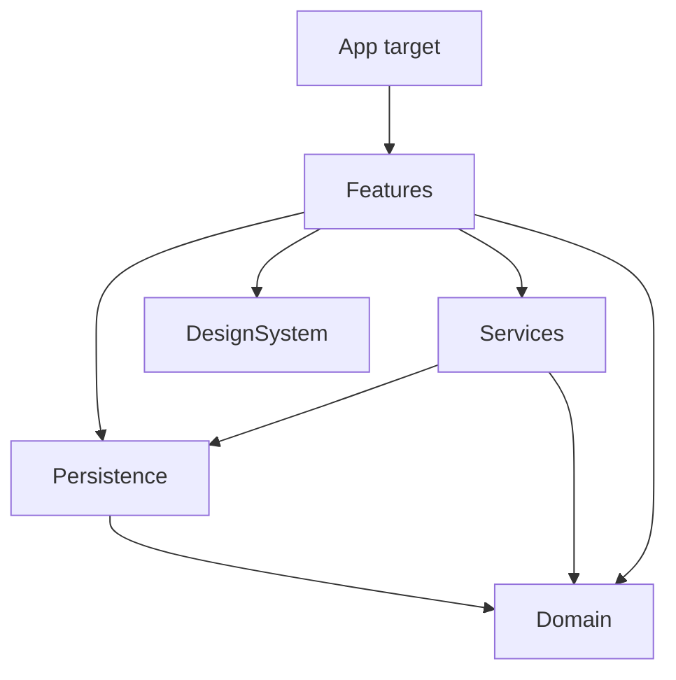

# Architecture

How Finlark is built today. This page says **what** the architecture is; the [ADRs](adr/README.md) say **why**. Each
section links to the ADR behind it.

Changing anything on this page needs an ADR, in the same commit. Terms follow the [glossary](glossary.md).

## Constraints

- iPhone, iOS 26+ (C-1). SwiftUI, SwiftData, the CloudKit private database, Swift Charts, LocalAuthentication and
  UserNotifications (C-2). No backend, and no network use except CloudKit (C-5, NFR-006).
- No third-party SDKs that collect data (NFR-007). New dependencies need the owner's approval and an ADR.
- The data model stays CloudKit-compatible: no unique constraints, every property optional or defaulted, every
  relationship optional (C-3).

## Modules

All code except the app's entry point lives in a local Swift package, `Packages/FinlarkKit`
([ADR-0003](adr/0003-module-structure.md)).



| Module | Owns | May import |
|---|---|---|
| `Domain` | Value types and pure rules: money, periods, splits, repayments, projection, recurrence dates, which notifications should exist | Foundation |
| `Persistence` | `@Model` types, versioned schemas and migrations, use cases, the duplicate cleanup step | Domain, SwiftData |
| `Services` | Notifications, App Lock, iCloud account status, per-device settings | Domain, Persistence, UserNotifications, LocalAuthentication, CloudKit |
| `DesignSystem` | Components, styles and design tokens, with no knowledge of the domain | SwiftUI |
| `Features` | Screens, drafts, the router | Domain, Persistence, Services, DesignSystem, SwiftUI |
| App target | Entry point, `ModelContainer` setup, wiring into the Environment, assets, entitlements | Everything above |

## Data

### Reading

Views read models with `@Query`. There are no view models for reading. Values that need rules, such as the balance,
totals and plan statuses, come from Domain functions applied to the query results
([ADR-0002](adr/0002-domain-logic-and-swiftdata.md)).

### Writing

```
View → draft (if the screen edits) → use case → Domain rules → models changed → one save
```

- Every write goes through a use case in Persistence, which saves once per user action (NFR-012). Use cases don't
  depend on SwiftUI, so App Intents can call them (NFR-011).
- A screen that edits several fields keeps them in an `@Observable` draft holding plain values. The draft checks
  Domain rules while the user edits and passes the result to a use case.
- The app target creates the use cases and puts them in the SwiftUI Environment.

### Money

Amounts are stored as `Int64` counts of the currency's minor units, next to their ISO 4217 code. Domain works only in
`Decimal`, and Persistence converts between the two. Balance, spending and projections are calculated, never stored
([ADR-0005](adr/0005-money-storage.md), NFR-005).

### Months

Every monthly calculation goes through Domain's period type, so a custom month start (roadmap 1.3) changes one place
([ADR-0003](adr/0003-module-structure.md)).

### Sync and the store

- The store lives in an App Group container and syncs to the CloudKit private database
  ([ADR-0009](adr/0009-store-location.md)).
- Pending items are calculated from recurring templates, not stored. Confirm and skip records are keyed by the
  template's ID and the occurrence date, and duplicates are cleaned up the same way on every device. Default data has
  a seed key, and two setups meeting through iCloud lead to the ONB-005 choice, never a silent merge
  ([ADR-0004](adr/0004-sync-duplicates.md), A-12).
- The schema is versioned from v1.0 (NFR-010). Once the CloudKit schema is in production, versions only add record
  types and fields ([ADR-0002](adr/0002-domain-logic-and-swiftdata.md)).

## System services

- **Notifications** are recalculated rather than scheduled one at a time. Domain works out which notifications should
  exist, and Services adds or removes the difference. This runs at launch, on return to the foreground, after each
  save and when synced data arrives ([ADR-0003](adr/0003-module-structure.md)).
- **App Lock** and the **iCloud account status** live in Services.
- **Settings** for notifications, IOU reminder days and App Lock are per device, in `UserDefaults`. Everything else in
  Settings is synced data ([ADR-0010](adr/0010-per-device-settings.md)).

## Navigation

A tab bar with Home, History and Settings, with one navigation stack per tab. An `@Observable` router in the
Environment owns the selected tab, each tab's path and the presented sheet ([ADR-0008](adr/0008-navigation.md)).

- Every pushed screen is a `Route` case, and every modal is a `Sheet` case. Destinations are built in one place.
- The tab bar shows only on each tab's root screen.
- Notification taps, and later App Intents and Spotlight, open screens through the router's `open(_:)`. Services
  reports taps as plain values, and the app target turns them into routes.

## Concurrency

Swift 6 language mode everywhere. Every module except Domain defaults to `MainActor` isolation. Domain has no default
isolation, and its types are `Sendable`. Models never cross actors. Work moves off the main actor only when a
measurement shows that it must ([ADR-0006](adr/0006-concurrency.md)).

## Testing

| Layer | Covers |
|---|---|
| Domain unit tests | Every rule, including the requirements' own examples |
| Draft and router tests | Draft validation, which screen a route opens |
| Persistence integration tests | Use cases, the duplicate cleanup step, migrations, on an in-memory store |
| UI smoke tests | Onboarding, add an expense, split and repay, confirm a pending item |
| Manual, before each release | iCloud sync, App Lock, notifications, accessibility and appearance |

Swift Testing for everything except UI tests, which use XCUITest ([ADR-0007](adr/0007-testing-strategy.md), NFR-009).

## Build and CI

- The shared `Finlark` scheme builds the app and runs every test target in `Finlark.xctestplan`:

  ```sh
  xcodebuild test -project Finlark.xcodeproj -scheme Finlark \
      -destination 'platform=iOS Simulator,name=iPhone 17,OS=27.0' CODE_SIGNING_ALLOWED=NO
  ```

- `scripts/lint.sh` runs swift-format over everything except `Finlark/DesignExplorations/`.
- GitHub Actions runs both on every push and pull request ([ADR-0011](adr/0011-build-and-ci.md), NFR-009).

## Where future releases plug in

| Release | Builds on |
|---|---|
| 1.3 Custom month start | Domain's period type |
| 2.0 App Intents | Use cases, and the router's `open(_:)` |
| 2.2 Widgets | The App Group store, Domain |
| 3.2 Multiple accounts | The multi-account data model (C-4) |
| 3.4 Multi-currency | The currency code stored with every amount (C-4) |

## Rules

Check these in every code review:

1. No module imports outside its row in [Modules](#modules).
2. Views never insert, change or delete models. Writes go through use cases.
3. Money is `Decimal` in Domain and `Int64` minor units in the store. Never `Double` or `Float`.
4. Domain never reads the clock, the calendar or the time zone itself. They're passed in.
5. Monthly calculations go through Domain's period type.
6. After v1.0 ships, schema changes only add record types and fields.
7. Every pushed screen is a `Route` case, and screens don't hide the tab bar themselves.
8. Only Services imports UserNotifications, LocalAuthentication or CloudKit.
9. `@unchecked Sendable`, `nonisolated(unsafe)` and `@preconcurrency` come with a comment saying why they're safe.

## Not decided yet

- The data model itself: entities, relationships and the v1.0 schema. It gets its own ticket.
- How the app picks up data written by extensions (v2.0, v2.2).
